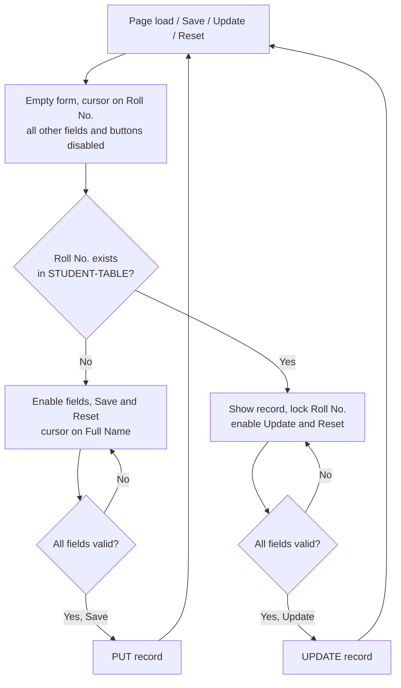

# Student Enrollment Form

A single-page student enrollment form that stores its records in JsonPowerDB.

## Table of Contents

- [Description](#description)
- [Benefits of using JsonPowerDB](#benefits-of-using-jsonpowerdb)
- [Scope of Functionalities](#scope-of-functionalities)
- [Illustrations](#illustrations)
- [Examples of Use](#examples-of-use)
- [Setup](#setup)
- [Release History](#release-history)
- [Project Status](#project-status)
- [Sources](#sources)
- [Other Information](#other-information)

## Description

This project is the Login2Xplore JsonPowerDB micro project. It is a Student Enrollment Form that saves and updates student records in the `STUDENT-TABLE` relation of the `SCHOOL-DB` database.

The whole application is one file, `index.html`, containing the markup, styles and script. It has no build step and no dependencies, and it talks to JsonPowerDB directly from the browser over its REST API.

| Field           | Notes                                 |
| --------------- | ------------------------------------- |
| Roll No.        | Primary key                           |
| Full Name       |                                       |
| Class           |                                       |
| Birth Date      | Cannot be in the future               |
| Address         |                                       |
| Enrollment Date | Cannot be earlier than the Birth Date |

## Benefits of using JsonPowerDB

As described by its developers, Login2Xplore:

- **Simple to use** – data is stored and retrieved as JSON through a small REST API, so a form can read and write records with a few HTTP calls.
- **Schema-free** – no tables or columns have to be defined in advance; the database and relation are created on the first `PUT`.
- **Serverless support** – the browser calls the database directly, so no back-end code has to be written or hosted. This speeds up development.
- **Fast, real-time indexing** – it is built on the PowerIndeX indexing engine, which is designed for quick lookups such as the `GET_BY_KEY` call this form uses.
- **Multi-mode DBMS** – it can be used as a document database, a key-value store or a relational database.
- **Lower development cost and time** – with no server layer or schema migrations, small projects like this one can be completed quickly.

## Scope of Functionalities

- Look up a student by Roll No. (primary key).
- Save a new student record.
- Update an existing student record; the Roll No. stays locked while editing.
- Reset the form at any point.
- Validation: no field may be empty, the Birth Date cannot be in the future, and the Enrollment Date cannot be earlier than the Birth Date.
- A save is re-checked against the database first, so an existing record is never overwritten by **Save**.
- Fields and buttons are locked while a save or update is in progress.
- If no connection token is configured, records are stored in the browser's `localStorage` so the form can be tried without an account.

Not included: deleting records, listing or searching all students, and user login.

## Illustrations

Form flow:



## Examples of Use

**Enrolling a new student**

1. Open `index.html`. The cursor is on **Roll No.**
2. Type `101` and press **Enter** or **Tab**. The message reads "New Roll No. Fill in the details and click Save."
3. Fill in Full Name, Class, Birth Date, Enrollment Date and Address.
4. Click **Save**. The record is stored and the form returns to its empty state.

**Updating an existing student**

1. Type `101` in **Roll No.** and press **Enter** or **Tab**. The stored details appear and Roll No. is locked.
2. Change any of the other fields, for example Class from `10-A` to `10-B`.
3. Click **Update**. The record is updated and the form returns to its empty state.

**Requests sent to JsonPowerDB**

Lookup, sent to `/api/irl`:

```json
{
  "token": "<connection-token>",
  "cmd": "GET_BY_KEY",
  "dbName": "SCHOOL-DB",
  "rel": "STUDENT-TABLE",
  "jsonStr": { "rollNo": "101" }
}
```

Save, sent to `/api/iml`:

```json
{
  "token": "<connection-token>",
  "cmd": "PUT",
  "dbName": "SCHOOL-DB",
  "rel": "STUDENT-TABLE",
  "jsonStr": {
    "rollNo": "101",
    "fullName": "Asha Rao",
    "studentClass": "10-A",
    "birthDate": "2011-04-02",
    "address": "12 MG Road",
    "enrollmentDate": "2026-06-01"
  }
}
```

## Setup

1. Sign up at [login2explore.com](https://login2explore.com) and generate a connection token (**Tools → Tokens**).
2. Open `index.html` and paste the token into `CONFIG.token` near the top of the script:

   ```js
   const CONFIG = {
     token: "",   // <-- your JPDB connection token
     ...
   };
   ```

3. Open `index.html` in a browser. The storage backend in use is shown at the bottom of the form.

| Setting       | Value                               |
| ------------- | ----------------------------------- |
| Base URL      | `http://api.login2explore.com:5577` |
| Database      | `SCHOOL-DB`                         |
| Relation      | `STUDENT-TABLE`                     |
| Lookup        | `GET_BY_KEY` on `/api/irl`          |
| Save / Update | `PUT` / `UPDATE` on `/api/iml`      |

## Release History

| Version | Date       | Changes |
| ------- | ---------- | ------- |
| 1.1.0   | 2026-11-11 | Fields and buttons lock during save and update. Stricter date and length validation. Clear message when a Roll No. already exists at save time. Safer handling of unexpected database responses. Added README and .gitignore. |
| 1.0.0   | 2026-11-11 | Initial release: Student Enrollment Form with Save, Update and Reset, storing data in `STUDENT-TABLE` of `SCHOOL-DB`. |

## Project Status

Complete for the micro project requirements. Possible future additions are deleting records and a list view of all students.

## Sources

- [Login2Xplore](https://login2explore.com) – JsonPowerDB and the micro project brief.
- [JsonPowerDB documentation](https://login2explore.com/jpdb/docs.html)

## Other Information

- **Token safety** – the connection token lives in client-side code, so anyone who can open the page can read it. Do not commit a real token to a public repository; keep `CONFIG.token` empty in the committed file.
- **HTTP only** – the JsonPowerDB API is served over plain HTTP. If this page is hosted on an HTTPS site such as GitHub Pages, the browser will block the database calls as mixed content. Open the file locally or serve it over HTTP instead.

Project structure:

```
index.html    Form markup, styles and script
README.md     This file
.gitignore
```
